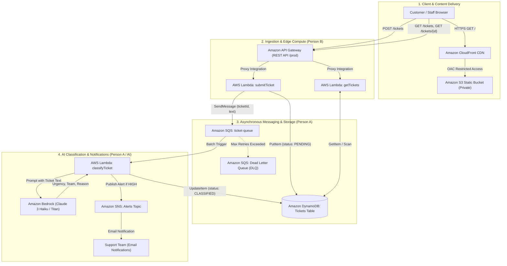

# Serverless Ticket Management System - Architecture

## System Overview

The system is a decoupled, serverless ticket triage platform built on AWS. It handles customer support requests with automated urgency rating and departmental routing using Amazon Bedrock generative AI.

## Architecture Diagram

## Request Journey (Steps 1–10)

1. **Static Content Delivery**: User navigates to the CloudFront distribution URL. CloudFront fetches and caches `index.html` from the private S3 bucket using Origin Access Control (OAC).
2. **Ticket Submission**: Customer fills the form and submits. The browser sends a `POST /tickets` request with JSON payload to API Gateway.
3. **Edge Validation & Ingestion**: API Gateway proxies the request to `submitTicket` Lambda. It validates input (rejects empty or >2000 character inputs with 400).
4. **State Persistence**: `submitTicket` generates a UUID, saves the ticket record to DynamoDB with `status = "PENDING"`, and pushes `{ticketId, text}` to the SQS `ticket-queue`.
5. **Immediate Client Acknowledgment**: `submitTicket` immediately returns HTTP `201/202 Accepted` with the `ticketId` so the client UI can begin polling without waiting for AI inference.
6. **Decoupled Queue Processing**: SQS triggers `classifyTicket` asynchronously in batches.
7. **Generative AI Triage**: `classifyTicket` formats a prompt and invokes Amazon Bedrock (Claude 3 Haiku) to evaluate urgency (`HIGH`, `MEDIUM`, `LOW`), department (`Tech`, `Finance`, `Account`, `General`), and justification.
8. **Record Enrichment**: `classifyTicket` updates the item in DynamoDB with the classification fields, setting `status = "CLASSIFIED"`.
9. **Staff Notification**: If urgency is `HIGH`, an alert is pushed to an Amazon SNS topic for immediate staff alerting.
10. **Polling & Dashboard Retrieval**: The browser queries `GET /tickets/{id}` and `GET /tickets`. `getTickets` Lambda retrieves the enriched ticket from DynamoDB and returns it to the UI.
